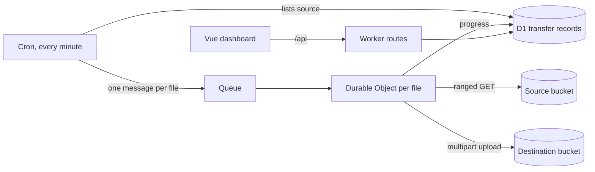

# s3-migrator

A Cloudflare Worker that copies every object from one S3-compatible bucket to another (AWS S3, Cloudflare R2, Backblaze B2 and others) and keeps the destination in sync. It runs entirely on Workers, with no servers or VMs, and comes with a dashboard for starting, pausing and watching transfers.

Tested with real data (83TB transferred in ~40hrs, averaging ~5000Mb/s)

## How it works



- **Discovery:** a cron job lists the source bucket a page at a time and records each new file in D1. Repeated passes pick up files added later, anywhere in the bucket.
- **Fan-out:** every file becomes a queue message. The number copying at once is capped by `MAX_CONCURRENT_MIGRATIONS`, and freed slots are refilled on the next cron run.
- **Copy:** each file gets its own Durable Object, which streams it across in 50 MiB parts with S3 multipart upload, three parts at a time. Progress survives restarts, because the object keeps its upload ID and finished parts.
- **Already there:** a file that already exists in the destination with the same size is marked complete without being copied.
- **Signing:** requests are signed with a small SigV4 implementation (`src/lib/s3Signing.ts`), so the Worker has no AWS SDK dependency.

## Features

- **Start and Pause:** Pause lets running transfers finish but starts nothing new. New installs start paused.
- **Throttling:** `429`, `503` and `SlowDown`/`TooManyRequests` responses mark a job as throttled. It then retries with backoff and jitter (5s, 15s, 30s, 45s, 60s), keeping the parts already uploaded. If it's still throttled after the last attempt, it fails and its upload is aborted. No new files start while any job is throttled.
- **Retries and a watchdog:**
    - **Failed files:** they're retried up to 3 times, and Retry All Failed resets them.
    - **Stuck jobs:** jobs stuck in progress for 10 minutes are queued again.
- **Skipped files:** some files are recorded as skipped with a reason and never copied:
    - keys with a `.` or `..` path segment, which URL normalisation would send to the wrong object;
    - files too large for a 10,000-part upload.
- **Abort:** you can abort one file or all of them, and aborted jobs stay stopped until you press Start or Retry. Reset transfers clears every record so the next Start begins fresh.
- **Dashboard:**
    - **Live view:** summary cards, a grid of every file and a table of active jobs with throttle countdowns.
    - **Source browser:** a paginated list of the source bucket.

## Setup

You need Node 22.18 or later, pnpm, and a Cloudflare account with Workers, D1, Queues and Durable Objects.

```sh
pnpm install

# Create the database and the queue
npx wrangler d1 create s3-migrator-registry
npx wrangler queues create s3-migrator-jobs

# Copy the example config, then fill in the D1 database ID and your bucket details
cp wrangler.example.jsonc wrangler.jsonc

# Generate the Env types from your config
pnpm cf-typegen

# Create the tables
pnpm db:migrate:local      # or db:migrate:remote before deploying
```

### Configuration

| Name | Kind | Purpose |
|---|---|---|
| `SOURCE_ENDPOINT`, `DESTINATION_ENDPOINT` | var | S3 API endpoint. R2 buckets in the EU jurisdiction need `https://<ACCOUNT_ID>.eu.r2.cloudflarestorage.com` |
| `SOURCE_BUCKET`, `DESTINATION_BUCKET` | var | Bucket names |
| `SOURCE_REGION`, `DESTINATION_REGION` | var | Signing region (`auto` for R2) |
| `SOURCE_PREFIX` | var | Copy only keys under this prefix (empty for everything) |
| `SOURCE_ACCESS_KEY_ID`, `SOURCE_SECRET_ACCESS_KEY` | secret | Read access to the source |
| `DESTINATION_ACCESS_KEY_ID`, `DESTINATION_SECRET_ACCESS_KEY` | secret | Write access to the destination |

Put the secrets in `.dev.vars` for local development, or set them with `npx wrangler secret put <NAME>`. Change buckets or keys only while paused with nothing in progress.

Tuning constants (concurrency, part size, retry schedule, timeouts) live in `src/constants.ts`.

## Commands

| Command | Purpose |
|---|---|
| `pnpm dev` | Run the Worker locally. It builds the dashboard first |
| `pnpm dev:dashboard` | Vite dev server for dashboard work. It proxies `/api` to `pnpm dev`, which must be running |
| `pnpm build:dashboard` | Build the dashboard into `dashboard/dist` |
| `pnpm typecheck` | Typecheck the Worker and the dashboard |
| `pnpm test` | Unit tests in `tests/`, run with Node's built-in test runner |
| `pnpm db:migrate:local` / `pnpm db:migrate:remote` | Apply D1 migrations |
| `pnpm run deploy` | Deploy to Cloudflare |

Local development has no cron. To run one scan, start `npx wrangler dev --test-scheduled` and request `/cdn-cgi/local/scheduled`.

`scripts/abort-multipart-uploads.sh <bucket>` aborts every unfinished multipart upload in a bucket, using the AWS CLI. It needs `S3_ENDPOINT` and `AWS_PROFILE`, and it asks before aborting anything. It doesn't filter by prefix, so pause the migrator first and don't point it at a bucket other tools upload to.

## Security

**The HTTP routes have no authentication,** including the ones that wipe transfer records. Put any hostname you deploy to behind [Cloudflare Access](https://developers.cloudflare.com/cloudflare-one/policies/access/), and keep `workers_dev` set to `false`.

## Limitations

- **Sync only adds files:** files deleted from or changed in the source aren't updated in the destination. "Already copied" is judged by size alone.
- **Small files:** freed slots are refilled once a minute, so throughput is capped at about `MAX_CONCURRENT_MIGRATIONS` new files a minute.
- **Long rescans:** keeping a large bucket in sync means relisting it continuously.

## Project layout

```
src/
  index.ts                  Worker entry: cron, queue and /api routes
  handlers/                 Cron discovery and queue dispatch
  durable-objects/          Per-file multipart copy (FileMigrator)
  lib/                      S3 client and signing, throttling, skip rules, helpers
  dashboard/                Server side of the dashboard API
dashboard/                  Vue 3 + Vite dashboard
migrations/                 D1 schema
tests/                      Unit tests for the Worker and the dashboard
```

## License

No license is granted. The code is published for reference, and all rights are reserved.
